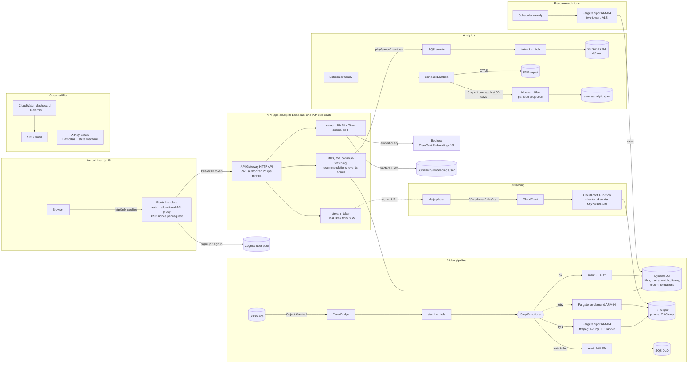

# bhavs architecture

## Why these choices
- **Token in the URL path, not a header or cookie.** The web app (vercel.app) and CloudFront (cloudfront.net) are
  different sites: third-party cookies are blocked and custom headers would trigger CORS preflight. HLS playlists use
  *relative* URLs, so every playlist and segment automatically inherits `/t/<token>/`. The function strips the token
  before the cache lookup, so all viewers share one cached copy.
- **Token = HMAC-SHA256(secret, "<expiry>:<title id>").** It is bound to one title and expires (4 h). The secret is
  in SSM (for the minting Lambda) and a CloudFront KeyValueStore (for the verifying function), never in git or
  Terraform state. `scripts/rotate_stream_key.sh` rotates both.
- **MediaConvert, Firehose and Kinesis are blocked by an Organization SCP**, so: ffmpeg on Fargate (Spot first, one
  on-demand retry), and SQS -> batch Lambda -> S3 -> Athena instead of Firehose. See docs/ACCESS.md.
- **Training on Fargate, not SageMaker**: the account's SageMaker training quota is 0. The same container would run as
  a SageMaker training job if the quota is ever approved.
- **No vector database**: ~20 titles fit in one JSON file; ranking them in plain Python takes microseconds.
- **Three Terraform stacks**: `bootstrap` (state bucket), `persistent` (data, auth, CDN; kept), `app` (compute; can be
  destroyed and recreated without losing data).
