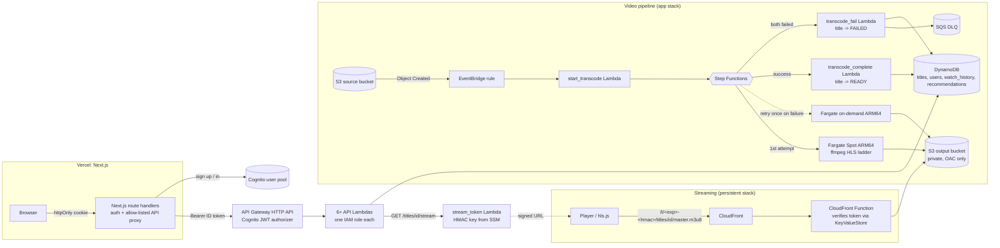

# bhavs architecture (through Phase 2)

## Why these choices
- **Token in the URL path, not a header or cookie.** The web app (vercel.app) and CloudFront (cloudfront.net) are
  different sites: third-party cookies are blocked and custom headers would trigger CORS preflight. HLS playlists use
  *relative* URLs, so every playlist and segment automatically inherits `/t/<token>/`. The function strips the token
  before the cache lookup, so all viewers share one cached copy.
- **Token = HMAC-SHA256(secret, "<expiry>:<title id>").** It is bound to one title and expires (4 h). The secret is
  in SSM (for the minting Lambda) and a CloudFront KeyValueStore (for the verifying function), never in git or
  Terraform state. `scripts/rotate_stream_key.sh` rotates both.
- **MediaConvert and Firehose are blocked by an Organization SCP**, so: ffmpeg on Fargate (Spot first, one on-demand
  retry), and (Phase 3) SQS -> batch Lambda -> S3 -> Athena instead of Firehose. See docs/ACCESS.md.
- **Switching to signed cookies later** only touches `infra/persistent/cdn.tf`, the viewer-request function and the
  `stream_token` Lambda; the pipeline and player URLs do not change.
